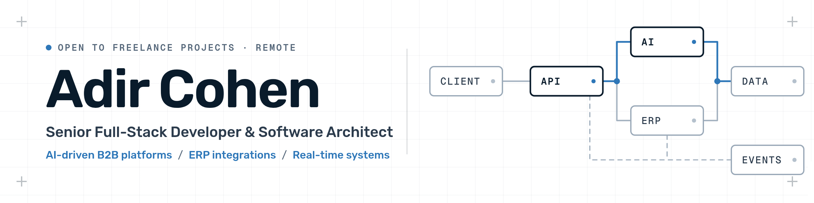

# Hi, I'm Adir Cohen 👋

**Senior Full-Stack Developer & Software Architect**
AI-Driven B2B Platforms · ERP Integrations · Real-Time Systems

I design and deliver AI-driven business platforms end to end, from architecture to production.
Co-founder of Onebtn, a B2B SaaS platform serving 60+ businesses, and an independent developer working with clients across medical, HR-tech, hospitality, travel and defense.

### What I build
- **AI-driven platforms**: systems that can be fully operated through AI, from business processes and workflows to interfaces and integrations
- **B2B & e-commerce platforms**: multi-tenant SaaS with web and mobile apps
- **ERP integrations**: Priority, SAP Business One and other ERP systems
- **Real-time systems**: map-based monitoring and control with live data

### Tech

### Let's talk
Available for freelance projects · Remote

Most of my work lives in private client repositories.
